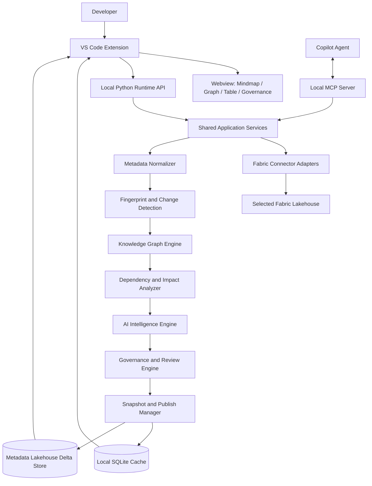
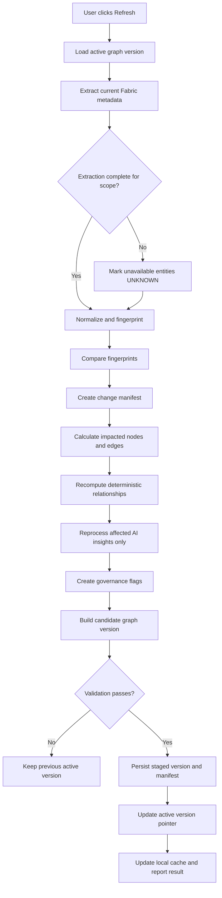

# Solution Architecture

## Fabric Lakehouse Intelligence Explorer

**Version:** 1.0  
**Date:** 2 November 2026  
**Architecture status:** Baseline

---

## 1. Architecture summary

The solution is a VS Code extension backed by a local Python runtime and local MCP server. The runtime connects to a selected Fabric Lakehouse, extracts metadata through capability-specific adapters, normalizes it, calculates fingerprints, builds a graph and performs incremental refresh. A local SQLite store provides a responsive cache and operational state. An optional Fabric metadata Lakehouse stores durable graph data, snapshots, change events, AI insights and governance decisions.

The architecture separates four concerns:

1. **Technical metadata:** facts extracted from Fabric.
2. **AI intelligence:** generated descriptions, domain suggestions and inferred relationships.
3. **Validated knowledge:** developer-approved business knowledge.
4. **Governance/history:** review decisions, audit records, snapshots and change events.

## 2. Context and boundaries

### Source system

One selected Microsoft Fabric Lakehouse. The source is read-only from this product.

### Persistence destination

An optional, separately configured metadata Lakehouse. It must not be assumed to be the source Lakehouse. It requires explicit write permissions.

### User interface

VS Code sidebar, commands and Webview. The Webview uses a graph visualization library such as React Flow.

### AI interface

Provider abstraction for approved LLM endpoints. AI is optional for core metadata extraction and graph construction.

### Agent integration

Local MCP server exposes reusable application capabilities to GitHub Copilot Agent and other MCP-compatible clients.

## 3. Logical architecture

## 4. Component responsibilities

### 4.1 VS Code extension

Responsibilities:
- Register commands and views.
- Manage active Lakehouse context.
- Initiate explicit build/refresh jobs.
- Display progress and scan results.
- Host the Webview UI.
- Provide authentication handoff to the local runtime using supported mechanisms.
- Present governance review actions and history.

The extension must not duplicate graph business logic.

### 4.2 Webview frontend

Recommended stack: React + TypeScript + React Flow (or equivalent graph visualization library).

Views:
- Overview.
- Mindmap.
- Relationship graph.
- Table and column explorer.
- Knowledge Governance.
- Snapshot comparison.
- AI assistant.

UI requirements:
- Lazy node expansion.
- Search and filters.
- Edge labels and provenance.
- Visual distinction between technical, AI-suggested and validated facts.
- Clear pending/approved/rejected/deprecated states.
- No full graph rendering by default for large Lakehouses.

### 4.3 Local Python runtime

Responsibilities:
- Expose a local service API to the extension.
- Manage scan jobs and cancellation.
- Maintain operational state.
- Coordinate connector, graph, AI, governance and storage services.
- Provide structured logs and health status.

The local runtime should bind only to loopback by default. Apply an authenticated local IPC/API boundary and validate requests from the extension.

### 4.4 Fabric connector

Adapter interfaces should hide Fabric-specific differences.

Candidate adapters:
- Fabric REST API adapter for workspace/item discovery and supported Lakehouse operations.
- OneLake/Delta metadata adapter for supported table metadata.
- SQL Analytics Endpoint adapter for SQL-visible metadata.
- Optional Spark metadata adapter where a supported execution environment is available.

The connector must advertise capabilities per Lakehouse/table. It must distinguish:
- Available and successfully retrieved.
- Not supported by this interface.
- Not authorized.
- Temporarily unavailable.
- Extraction failed.

Never treat unavailable metadata as an empty value or a deletion.

### 4.5 Metadata normalizer

Converts connector-specific responses into canonical models. Preserves original source IDs and source metadata. Generates stable IDs where Fabric identifiers are unavailable. Normalizes types, names, nullability, descriptions and supported constraints.

### 4.6 Fingerprint and change detection engine

Generates canonical hashes for Lakehouse, table, column, relationship and AI input contexts. Compares current extraction to the active graph version and emits a change manifest.

### 4.7 Knowledge graph engine

Manages nodes, edges, provenance, graph traversal and version-aware graph reads. Delta tables are the persistence model; Python adjacency/index structures support traversal. A dedicated graph database is not required for v1.

### 4.8 Relationship engine

Three evidence classes:
- Declared physical: explicitly exposed constraints or metadata.
- Rule-inferred: naming/type/key-pattern heuristics.
- AI-inferred: semantic interpretation of metadata.

Every edge carries evidence type, source, confidence if meaningful, validation state and supporting entity fingerprints. Physical evidence does not automatically equal business approval.

### 4.9 AI intelligence engine

AI modules:
- Table/column description generator.
- Business domain classifier.
- Relationship suggestion engine.
- Semantic concept classifier.
- Natural-language graph question answering.

AI inputs are metadata-only in v1. AI output is stored as proposals with model, prompt, input fingerprint and timestamp. AI is not required for technical graph construction.

### 4.10 Governance engine

Enforces approval policies:
- AI domain suggestions require review.
- All AI-inferred relationships require review.
- AI cannot overwrite validated knowledge.
- Changed AI suggestions create flags and new proposal versions.
- Rejected proposals are remembered against evidence fingerprints.
- Approved knowledge invalidated by technical changes is flagged for review, not silently deleted.

### 4.11 Snapshot and publish manager

Builds a candidate graph version, validates it, persists records, writes a manifest and only then updates the active graph-version pointer. Because Delta transactions are table-scoped, do not assume atomic multi-table transactions. Use staging/versioned records and a final active-pointer update.

## 5. Data flow: initial build

1. User authenticates and selects one Lakehouse.
2. Connector performs capability discovery.
3. Metadata is extracted with completeness/status markers.
4. Normalizer creates canonical entities.
5. Fingerprint engine creates initial fingerprints.
6. Graph engine creates technical nodes and edges.
7. Relationship engine adds declared physical edges and candidate suggestions.
8. AI engine optionally enriches descriptions/domains/relationships.
9. Governance engine places AI proposals in review queues.
10. Validator checks IDs, references, duplicate edges, provenance and completeness.
11. Snapshot manager publishes version 1.
12. Local cache is updated; optional Fabric metadata store is synchronized.

## 6. Data flow: manual incremental refresh

Refresh rules:
- Explicit user initiation only.
- One active scan per Lakehouse context unless concurrency is deliberately supported.
- Use scan IDs and base graph version for idempotency and conflict detection.
- A failed extraction must not produce a deletion event.
- Deletion requires a complete authoritative discovery result for the relevant scope.
- AI outage does not block technical graph publication; mark AI enrichment pending.
- If remote persistence fails, keep local candidate state pending sync and clearly report it.

## 7. Hybrid storage architecture

### Local SQLite

Stores:
- Cached active graph and indexes.
- Scan/job state.
- Local configuration and selected Lakehouse context.
- AI processing cache.
- Pending synchronization operations.
- Local-only graph data when remote write access is unavailable.

SQLite is a cache and local operational store, not the sole authority when Fabric persistence is configured and synchronized.

### Fabric metadata Lakehouse

Stores Delta tables for:
- Nodes and edges.
- Table and column metadata.
- AI insights and dependencies.
- Domain and relationship suggestions.
- Validated knowledge and decisions.
- Snapshots, manifests and change events.
- Scan and synchronization state.

### Synchronization

- Use stable IDs and idempotent upserts.
- Maintain local and remote graph versions.
- Detect conflicting updates instead of last-write-wins overwriting governance decisions.
- Treat governance decisions as immutable events.
- Reconcile pending operations after connectivity returns.

## 8. MCP architecture

MCP is an integration boundary, not a separate business logic implementation.

### Discovery tools
- `list_workspaces`
- `list_lakehouses`
- `get_lakehouse_metadata`
- `list_tables`
- `get_table_schema`
- `get_table_metadata`

### Graph tools
- `get_graph`
- `get_related_tables`
- `get_table_dependencies`
- `compare_snapshots`

### Refresh tools
- `build_graph`
- `refresh_graph`
- `get_scan_status`

Refresh tools require explicit invocation and must not be triggered by passive browsing or ordinary read-only questions.

### Intelligence tools
- `explain_table`
- `classify_business_domains`
- `discover_relationships`
- `ask_lakehouse`

### Governance tools
- `get_domain_suggestions`
- `approve_domain`
- `modify_domain`
- `reject_domain`
- `get_relationship_reviews`
- `approve_relationship`
- `reject_relationship`
- `get_change_flags`
- `get_governance_history`

All MCP operations call the same application services as the VS Code extension. Governance authorization and validation are enforced server-side.

## 9. Authentication and security

- Microsoft Entra ID authentication.
- Prefer delegated user access for interactive discovery.
- Use supported VS Code/Azure Identity authentication integrations; validate the exact flow against the selected Fabric APIs.
- Store tokens through secure credential storage; never persist raw tokens in SQLite, logs or settings.
- Use least privilege.
- Source Lakehouse access is read-only.
- Metadata Lakehouse write access is separate and optional.
- Local runtime listens on loopback by default and validates local callers.
- Do not expose the local MCP server on a network interface unless explicitly designed and secured.
- AI requests contain metadata only; allow AI enrichment to be disabled.

## 10. Reliability and consistency

### Graph publication

1. Create candidate version records.
2. Validate node and edge references.
3. Validate uniqueness and provenance.
4. Validate snapshot manifest counts/checksums.
5. Persist candidate data.
6. Atomically update the active-version pointer within its control record/table operation.
7. Mark scan complete.

If publication fails, previous version remains active. Candidate records can be cleaned up or resumed.

### Recovery

- Persist scan state and stage checkpoints.
- Use idempotent writes.
- Resume or safely restart interrupted scans.
- Never mark a scan completed before the active pointer is updated.
- Maintain explicit local/remote sync states.

## 11. Observability

Structured events should include:
- scan_id, lakehouse_id, base_version, candidate_version.
- stage, status, duration and counts.
- tables/columns discovered and changed.
- AI calls, cache hits and failures.
- validation errors.
- synchronization status.

Do not log tokens, secrets or unnecessary sensitive content.

## 12. Deployment and runtime model

Initial deployment:
- VS Code extension installed by developer.
- Python runtime and MCP server launched locally by the extension or configured development environment.
- React Webview assets packaged with extension.
- Local SQLite database stored in a VS Code-managed extension storage location.
- Fabric metadata Lakehouse configured separately when persistence is enabled.

Package Python dependencies reproducibly and pin supported versions. Define supported OS/runtime matrix during implementation.

## 13. Key architecture decisions

| ADR | Decision |
|---|---|
| ADR-001 | VS Code is primary UX |
| ADR-002 | Local Python runtime hosts shared services |
| ADR-003 | Local MCP exposes shared services |
| ADR-004 | Metadata-only source inspection |
| ADR-005 | Hybrid deterministic and AI processing |
| ADR-006 | Delta-backed graph model; no graph DB required for v1 |
| ADR-007 | Fingerprint-based incremental refresh |
| ADR-008 | Manual refresh only |
| ADR-009 | Local cache plus optional Fabric Delta persistence |
| ADR-010 | Full graph snapshots and change events |
| ADR-011 | Technical, AI and validated knowledge are separate |
| ADR-012 | AI domains require developer approval |
| ADR-013 | AI-inferred relationships require developer approval |
| ADR-014 | AI changes are flagged, not silently applied |
| ADR-015 | Source Lakehouse is read-only |

## 14. Technical risks and validation spikes

Before implementation is considered production-ready, validate:
1. Metadata coverage across the target Lakehouse table formats and schema modes.
2. Which interfaces expose column metadata, descriptions, constraints and Delta metadata.
3. Authentication and token audience requirements for each API.
4. Whether metadata Lakehouse Delta writes are available through the selected local runtime path.
5. Webview performance with representative graph sizes.
6. Local MCP transport and Copilot Agent compatibility.
7. Full snapshot storage cost and retention strategy.
